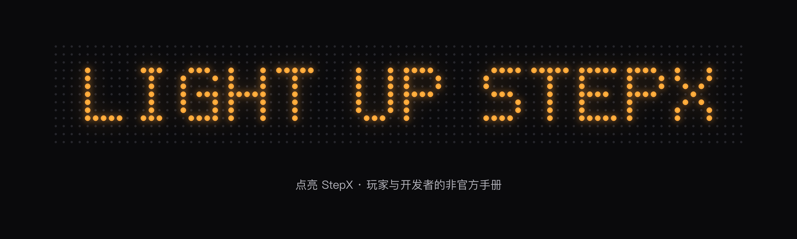

# Light Up StepX · 点亮 StepX

StepX Neo 玩家与开发者的非官方手册。我们把在这台手机上实测过的玩法、开发经验和踩过的坑写下来，把大家想要的能力公开记在一块看板上。

> 本项目由玩家和开发者自发维护，与阶跃星辰没有隶属关系。官方信息以官方渠道为准。

## 从哪里看起

| 你想做什么 | 看这几篇 |
|---|---|
| 刚拿到手机，想知道它特别在哪 | [这台手机有什么不一样](docs/01-what-is-different.md) · [常见问题](docs/02-faq.md) · [官方资料入口](docs/16-official-resources.md) |
| 玩机 | [换壁纸](docs/03-wallpaper.md) · [背屏能显示什么](docs/04-rear-screen.md) |
| 用 Step Studio 做应用 | [Step Studio 上手](docs/05-studio-basics.md) · [连接器能力表](docs/06-connectors.md) · [背面点阵屏连接器详解](docs/07-rear-screen-connector.md) · [能与不能（实测清单）](docs/08-can-and-cannot.md) · [怎么给 Studio 提需求](docs/09-prompting-studio.md) |
| 做原生安卓应用、上架 | [原生安卓应用能做什么](docs/10-native-android.md) · [上架](docs/11-publishing.md) |
| 看别人做了什么 | [作品列表](docs/12-showcase.md) |
| 避坑 | [踩坑记录](docs/14-pitfalls.md) |
| 提需求、一起做 | [许愿池](docs/13-wishlist.md) · [怎么参与](docs/15-contribute.md) |

全部文档见[全站索引](docs/17-index.md)，最近改了什么见[更新日志](docs/18-changelog.md)。

## 我们怎么写

- **只写试过的。** 每篇文档标明内容来源：实测、官方资料、Studio 回答（在 Studio 里提问得到、没有逐条真机验证）或整理。没验证的会写明没验证。
- **写给普通用户，也写给开发者。** 不需要会写代码也能看懂前半部分。
- **愿望公开。** 想要官方开放的能力、想有人做的应用，记在[许愿池看板](https://ncngqg6sl1x7.feishu.cn/wiki/LByNwdOiZiX8Oek9oGucFOXMn6b?table=tblvxYrNgKES9R9U&view=vew3i77ew0)上，谁提的、有没有人认领、官方有没有回应，所有人都看得到。
- **有边界。** 只写任何用户通过官方渠道能看到、能做到的事。不收录系统内部细节，不写绕过系统限制的方法。

实测环境是 StepX Neo、Step AOS 1.0.0.2。系统更新后情况可能变化，发现过时请告诉我们。

## 怎么参与

- **许愿**：一句话就行，写进[许愿池看板](https://ncngqg6sl1x7.feishu.cn/wiki/LByNwdOiZiX8Oek9oGucFOXMn6b?table=tblvxYrNgKES9R9U&view=vewgneccHQ)，或者在本仓库开一个 issue。
- **纠错、补充**：开 issue 或直接提 PR，格式见[怎么参与](docs/15-contribute.md)。
- **聊天**：交流群入口在[飞书知识库首页](https://ncngqg6sl1x7.feishu.cn/wiki/PhtTwhQ5gibjb6kMT2UcKKTDnHb)。

`docs/` 里的正文和飞书知识库是同一份内容。飞书那边适合在手机上读，这里适合搜索、引用和提修改。文中说的"在本页评论"指飞书页面，在这里请开 issue。

## 社区里的其他资料

- [StepX Neo 研究所](https://github.com/JiayuStudio/stepx-neo-lab)：社区应用、游戏和开发教程的索引，偏开发者。收录范围和我们不同，其中的内容没有经过我们验证。

## English

Light Up StepX is an unofficial, community-written handbook for the StepX Neo, the AI phone made by StepFun. It covers what we have actually tested on the device: everyday tweaks, building apps with Step Studio and its connectors, the 17 × 23 dot-matrix rear display, publishing, and known pitfalls. Feature requests are tracked on a public wish board.

The documents are in Chinese for now. Issues in English are welcome.

## 许可

文档和图片以 [CC BY 4.0](LICENSE) 发布：可以转载和改编，请注明出处"Light Up StepX"并附本仓库链接。文中提到的第三方应用和官方资料，版权归各自所有者。
