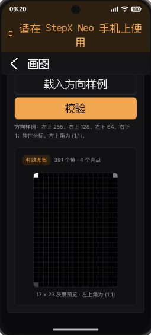

# Step Studio 上手

实测环境：StepX Neo · Step AOS 1.0.0.2 · 2026-11-10 · 按官方资料校对于 2026-11-11

Step Studio 是官方的应用、智能体与技能开发平台，网页版，地址 studio.stepx.com，目前是 Beta。用手机号加短信验证码登录，首次登录自动建号。官方另有一份《Step Studio 官方知识库》，入口和摘要见 [官方资料入口](16-official-resources.md)；本页和它不一致的地方，以官方为准。

【更新说明】官方在 10 月 29 日的更新说明里预告"Step Studio 移动端即将上线"。我们目前用的是网页版。

## 三种构建器

| 构建器 | 页面上的说明 | 官方知识库说适合做什么 |
|---|---|---|
| 应用构建器 | 借助 AI，更快地创建应用 | 对客应用、配套后台、网页小游戏 |
| 智能体构建器 | 部署、监督对话 Agent | 能对话、能调用工具办事的智能体 |
| 技能构建器 | 使用 AI 创建和迭代技能 | 把一个固定能力封装成可复用的技能 |

侧栏还有：我的项目、连接器、模版、组件库、主题、收件箱、设置。下面只讲我们实际用过的应用构建器。

## 应用项目的工作区

左边是开发对话，右边是应用面板。

| 入口 | 用来做什么 |
|---|---|
| 对话 | 描述需求、追加修改，可以上传附件、选择模型。【官方知识库】目前可选 Step 5 Preview 和 DeepSeek V4.1 Flash |
| 配置 | 四块：发布和上架、用户和授权、数据库、集成。连接器在"集成"里添加 |
| 文件 | 文件树和代码编辑器，可以直接改代码、新建文件、上传文件 |
| 预览 | 在网页里运行应用，带"点选元素"的编辑工具 |
| 真机测试 | 【官方知识库】应用是获取体验安装包，装到安卓真机上测试；网页游戏通过链接或二维码在手机浏览器里试玩 |
| 发布 | 生成正式版本，见下面的"测试、发布与上架" |

"配置 → 用户和授权"管的是你这个应用自己的用户（登录页、用户表），和手机系统能力的授权无关。官方知识库也提醒：Step Studio 的登录和作品里的用户登录是两回事，只配了登录页面而没做数据权限，不同用户可能看到同一份数据。

## 版本

【实测】每轮对话结束会生成一个版本，形如"第 1 轮 · 一串版本号"。可以查看任一版本的预览，也可以"还原到此版本"。我们做过的几轮，每轮用时在 18 到 37 分钟之间，期间不用守着。

【官方知识库】作品有三种版本：开发版本是正在编辑和预览的；测试版本在真机测试时生成；正式版本在发布后生成，不能直接改，连的是线上数据。开发环境和正式环境的数据互相独立。

## 工程是什么样的

【实测】生成的是标准的 Node + Vite 前端工程（TypeScript）。文件面板里能直接编辑和上传文件，所以也可以在本地写好代码再放进去，不必全靠对话生成。构建在 Studio 的云端完成。

要注意：

- 网页预览调不了手机能力，背屏、震动这类功能必须真机测试。官方知识库的说法是，依赖真实设备的能力必须用真机测试，"模拟成功也不代表真正接通"。
- 【实测】我们没找到导出源码或关联 Git 的入口。重要的需求和关键代码，建议自己在本地另存一份。希望官方提供，已写进 [许愿池](13-wishlist.md)。

## 点阵校验器实测

2026-11-14，我们给「StepX 点阵」的画图页加了图案校验器。它接收两种 JSON 写法：含 391 个亮度值的一维数组，或 23 行、每行 17 个值的二维数组。每个值都是 0 到 255 的整数。这样可以先在网页里查出少了一行、亮度越界或行列写反等问题。

1. **在私仓写需求和验收样例。** 我们给四角设了不同的亮度：左上 255、右上 128、左下 64、右下 1。用四个不同值，行列颠倒或左右翻转时更容易发现。
2. **请 Studio 实现，在最终版本的网页预览里试。** 进入「画图」→「图案校验器」→「载入方向样例」→「校验」，得到 391 格、4 个亮点，四角灰度与样例一致。把第 2 行第 3 列改为 256，旧预览随编辑消失，再校验会报出该行列。391 个零也能通过，并显示「空白图案」。
3. **从「文件」面板读回改动，再推送 GitHub。** 这轮新增了校验函数和界面组件，修改了画图页。我们逐个打开这三个文件、复制完整内容，与上一版对照后，在本地运行 60 项测试，全部通过，再将改动推到私仓。这个流程可以手动完成。

**Neo 真机验收待做。** 本轮已核对网页里的软件坐标。还要在手机上检查触控和窄屏排版，并确认载入样例、执行校验时原画布和实体背屏都保持原样。

本轮分工：Step Studio 生成应用改动，Codex 编写需求与样例、检查网页预览、读回源码并运行独立测试。

## 测试、发布与上架

【官方知识库】三件事要分开看：

- **测试**：不依赖设备的部分在预览里调好；依赖设备的，应用获取体验安装包装到手机上测，智能体和技能扫码后在手机的 Amoo 空间里安装或添加。
- **发布**：生成正式版本，不需要上架审核。发布后，应用可以通过链接或二维码私域分享。
- **上架**：把作品提交到 AmooStore，通过审核后，手机用户才能在 AmooStore 里找到。上架需要完成开发者个人实名认证。

知识库原话："发布不等于上架。生成正式版本后，不代表作品已在市场中公开展示。"后续修改作品，要重新测试并发布，才会更新用户在用的版本。

三类作品的发布规则不同：

| 作品 | 发布与上架 |
|---|---|
| 应用 | 先发布正式版本，再点"提交到 AmooStore"并上传上架材料，审核通过后出现在 AmooStore 的"AI 应用"栏；上架后不支持回滚 |
| 智能体 | 发布即上架，要实名认证并签署开发者协议，未成年不可上架；审核中可以撤回 |
| 技能 | 先发布、再上架。发布后可以在智能体和应用里被配置调用；上架要人工审核 |

细节见 [上架](11-publishing.md)。

## 开发者实名认证

在 Studio 的 设置 → 账号管理 → 开发者认证 里提交，页面写的是"预计 1–3 个工作日完成审核"。上架 AmooStore 需要先完成这一步。STEPX 开发者中心另有自己的实名认证，两者的关系官方资料没有说明，见 [上架](11-publishing.md)。

## 下一步

- 想知道有哪些能力可用：[连接器能力表](06-connectors.md)
- 先确认做不做得到：[能与不能（实测清单）](08-can-and-cannot.md)
- 怎么写需求：[怎么给 Studio 提需求](09-prompting-studio.md)
- 准备上架：[上架](11-publishing.md)
